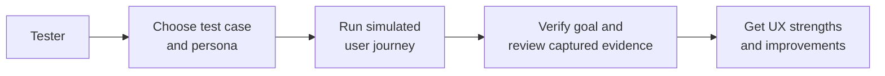
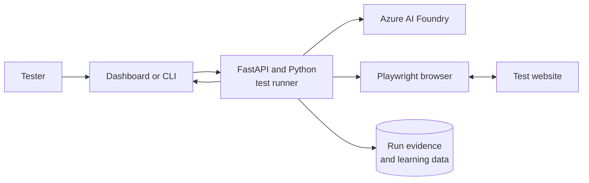
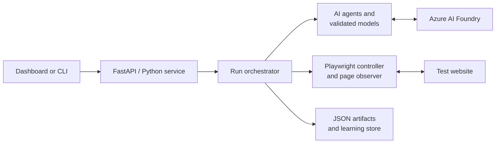

# Project architecture

This document describes the **currently implemented** AI Persona-Based UX Testing Agent. It has a React + TypeScript dashboard, a FastAPI API, a Python/Playwright test runner, Azure AI Foundry integration, file-based run evidence, evidence-grounded UX analysis, and adaptive retry/learning support. The dashboard currently displays backend status, personas, and test-case information; test execution is available through the CLI and run API, not dashboard controls.

## 1. Functional architecture

Shows the user-facing capabilities and the lifecycle of a persona-based journey.

## 2. Overall system architecture

Shows the system boundary and external dependencies. Test cases and personas are local JSON/Python data; run evidence and learning data are stored on disk. No database service is currently used.

## 3. Technical architecture and execution flow

Shows the main software modules and integrations. The model returns validated actions; Playwright executes them, while run outputs are persisted as files.

### Key implementation boundaries

- **Inputs:** JSON cases in `test_cases/`; persona definitions in `backend/app/personas/`; configuration from environment variables or ignored local settings.
- **Execution:** `backend/app/orchestrator/` coordinates runs; `backend/app/agents/` handles model decisions and UX analysis; `backend/app/browser/` observes and drives pages; `backend/app/models/` defines validated data contracts.
- **Safety:** The browser controller limits top-level navigation to the case's allowed public HTTPS domain and blocks private/reserved destinations, sign-in/checkout/purchase flows, and sensitive input. Bot checks/CAPTCHAs stop a run without bypass attempts.
- **Persistence:** `artifacts/` holds batch manifests, run results, action histories, screenshots, and WebM video. `learning/` holds JSON learning records and reusable experiences.
- **Not currently implemented:** axe-core scanning, a report-generation/review workflow, dashboard run controls, and a local demo storefront. UX analysis is LLM-generated and evidence-validated; it is not an axe-core scan or a substitute for user research.
